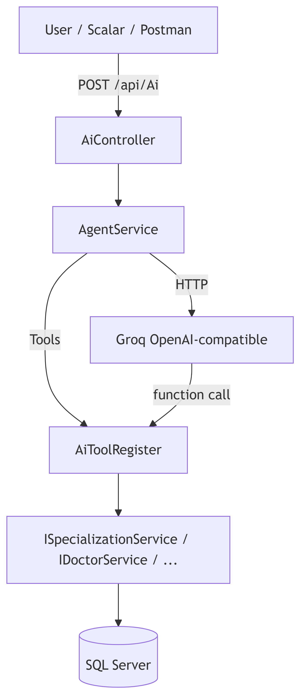

# MediFlow AI

MediFlow AI is a **.NET 10 demonstration API** for a medical booking platform. It shows how a backend can expose real business logic through REST—and how an **LLM agent** can use that same logic via **function calling** (tools) to search doctors, check slots, book appointments, and add reviews in natural language.

No direct database access from the AI: the model calls **10 tools** that run through your application services and Entity Framework, just like normal API code.

---

## Features

| Area | What you get |
|------|----------------|
| **REST API** | Specializations, patients, doctors (with optional `availableSlots`), schedules, appointments, reviews |
| **AI chat** | `POST /api/Ai` — Groq / OpenAI-compatible LLM with automatic tool invocation |
| **Clean architecture** | `Api` → `Services` → `Infrastructure` (no repository layer; demo-friendly) |
| **Dummy data** | Bogus seed + auto-fill schedules (−3 to +10 days UTC), demo patient for booking |
| **OpenAPI** | [Scalar](https://scalar.com/) API reference in Development |

---

## Architecture

```text
┌─────────────┐     POST /api/Ai      ┌──────────────┐     tools      ┌─────────────────┐
│   Client    │ ────────────────────► │ AgentService │ ─────────────► │ AiToolRegister  │
│ (Scalar/UI) │                       │  + Groq LLM  │                └────────┬────────┘
└─────────────┘                       └──────────────┘                         │
       │                                                                       ▼
       │ REST                                                           Application services
       ▼                                                                       │
┌─────────────┐                                                                ▼
│ Controllers │ ───────────── Application services ─────────────────────►  SQL Server
└─────────────┘
```



**Request flow (AI):** `AiController` → `AgentService` → LLM → `AiToolRegister` (10 snake_case tools) → public service methods or `PatientAppointmentTools` → application services → `AppDbContext`.

---

## Solution structure

```
MediFlowAI/
├── README.md
├── AI Integration Steps.md      ← Reusable step-by-step AI integration guide
├── image.png
├── scripts/
│   ├── test-apis.ps1            ← REST smoke test (curl)
│   └── test-apis-curl.md
└── src/
    ├── MediFlowAI.Api/          → HTTP host, controllers, seed, system-prompt.md
    ├── MediFlowAI.Services/     → Business logic + AI (AgentService, AiToolRegister)
    ├── MediFlowAI.Dto/          → API DTOs (DoctorDto, PatientDto, ChatRequest, …)
    ├── MediFlowAI.Domain/       → Entities
    └── MediFlowAI.Infrastructure/ → EF Core, migrations, configurations
```

| Project | Role |
|---------|------|
| **MediFlowAI.Api** | ASP.NET Core Web API, DI wiring, `DatabaseMigrator`, Scalar |
| **MediFlowAI.Services** | Service interfaces + implementations, AI layer |
| **MediFlowAI.Dto** | Records passed to/from controllers and services |
| **MediFlowAI.Domain** | `Doctor`, `Patient`, `Appointment`, `DoctorSchedule`, … |
| **MediFlowAI.Infrastructure** | `AppDbContext`, fluent configs, SQL migrations |

---

## Prerequisites

- [.NET 10 SDK](https://dotnet.microsoft.com/download)
- SQL Server **LocalDB** (default connection string) or update `ConnectionStrings:DefaultConnection` in `appsettings.json`
- **Groq** (or **OpenAI**) API key for the AI endpoint, or an API key from any **OpenAI-compatible provider**.

---

## Quick start

### 1. Clone and configure the LLM key

```bash
dotnet user-secrets set "AgentOptions:ApiKey" "YOUR_GROQ_KEY" --project src/MediFlowAI.Api
```

`AgentOptions:ApiKey` is commented out in `appsettings.json` on purpose—do not commit secrets.

### 2. Run the API

```bash
dotnet run --project src/MediFlowAI.Api
```

On first run: EF migrations apply, dummy data seeds (if the database is empty), demo patient and schedule slots are ensured.

| URL | Use |
|-----|-----|
| https://localhost:7141/scalar/v1 | Scalar API docs + try requests |
| http://localhost:5167/scalar/v1 | HTTP profile |

### 3. Smoke-test REST (optional)

```powershell
powershell -File scripts/test-apis.ps1
```

Edit `$Base` in the script if your launch port differs.

### 4. Try the AI

In Scalar, open **`POST /api/Ai`**:

```json
{
  "message": "List Pediatrics doctors and show available slots tomorrow"
}
```

Or omit `userId` to use the built-in **demo patient** (see below).

---

## AI integration (read this for demos)

AI configuration, **10 tools**, direct service registration, patient context, and the complete integration pattern are documented in:

### [**AI Integration Steps.md**](AI%20Integration%20Steps.md)

That guide is the main reference for:

- `AgentOptions`, `system-prompt.md`, and `SystemPromptResolver`
- Provider factory and dependency-injection setup
- Direct service methods as typed AI tools
- Request-bound patient actions and ownership checks
- Prompt, chat history, timeout, and final-response handling
- Validation steps and production considerations

**Short summary:** User sends a message → Groq calls tools like `search_doctors` or `book_appointment` → registered service methods return typed DTOs; patient operations enforce request context and ownership → services hit the real database → the model replies in plain English.

---

## Demo patient (AI booking user)

For booking and reviews, the API defaults to a seeded patient when `userId` is omitted:

| | Value |
|---|--------|
| **Id** | `019e513f-b4aa-7dc3-aa1d-2ed781164ae0` |
| **Name** | Demo Patient (AI User) |

Defined in `src/MediFlowAI.Api/Demo/DemoPatient.cs` and ensured on every startup.

```json
{
  "message": "Book the first available Pediatrics slot on 2026-05-26",
  "userId": "019e513f-b4aa-7dc3-aa1d-2ed781164ae0"
}
```

---

## REST API overview

Base path: `/api/{controller}`

| Controller | Examples |
|------------|----------|
| **Specializations** | `GET /api/Specializations`, `GET /api/Specializations/search?q=card` |
| **Patients** | `GET /api/Patients`, `GET /api/Patients/search?q=Demo` |
| **Doctors** | `GET /api/Doctors`, `GET /api/Doctors/specialization/name/Pediatrics?date=2026-05-26` |
| **Schedules** | `GET /api/Schedules/available?doctorId={id}&date=yyyy-MM-dd` |
| **Appointments** | `POST /api/Appointments/book`, `GET /api/Appointments/patient/{id}` |
| **Reviews** | `POST /api/Reviews` |
| **Ai** | `POST /api/Ai` — natural language + tools |

**Doctor slots on list:** pass optional `?date=yyyy-MM-dd` on doctor endpoints to populate `availableSlots` on each `DoctorDto`.

---

## Dummy data (testing)

Seeded and maintained in `DatabaseMigrator.cs`:

| Rule | Detail |
|------|--------|
| Specializations | 6 (Cardiology, Dermatology, Pediatrics, Orthopedics, Neurology, General Practice) |
| Doctors | 2 per specialization, all active |
| Patients | Demo patient + 24 random |
| Schedule window | **3 days ago → 10 days ahead** (UTC) |
| Clinic hours | 09:00–16:00 UTC, Mon–Thu all doctors; Fri/Sat one doctor per specialty |
| Appointments | ~35% of slots pre-booked for realistic availability |

**Fresh database:** delete the `MediFlowAI` LocalDB database and restart the API to reseed.

**Dates:** Available-slot queries only return future, unbooked times (`StartTime >= UtcNow`). Use a weekday inside the seed window for reliable demos.

---

## Configuration

**File:** `src/MediFlowAI.Api/appsettings.json`

```json
"AgentOptions": {
  "Provider": "OpenAILike",
  "Endpoint": "https://api.groq.com/openai/v1",
  "Model": "meta-llama/llama-4-scout-17b-16e-instruct",
  "SystemPromptFile": "system-prompt.md",
  "TimeoutSeconds": 90,
  "MaximumToolIterations": 12,
  "SystemPrompt": "..."
}
```

| Setting | Purpose |
|---------|---------|
| `Provider` | `OpenAI` or `OpenAILike` (OpenAI-compatible endpoint) |
| `Endpoint` | Required for `OpenAILike`, including the API base path such as `/openai/v1` |
| `ApiKey` | Set via User Secrets or `AgentOptions__ApiKey` env var |
| `SystemPromptFile` | Markdown prompt in the Api project (preferred if file exists) |
| `TimeoutSeconds` | Maximum duration of one AI request, including tool calls |
| `MaximumToolIterations` | Stops an accidental or unproductive tool loop |

Edit **`src/MediFlowAI.Api/system-prompt.md`** to tune AI behavior without changing C#.

---

## Tech stack

- ASP.NET Core 10, EF Core 10, SQL Server  
- [Microsoft.Extensions.AI](https://www.nuget.org/packages/Microsoft.Extensions.AI) + OpenAI-compatible client (Groq)  
- [Bogus](https://github.com/bchavez/Bogus) for seed data  
- [Scalar.AspNetCore](https://www.nuget.org/packages/Scalar.AspNetCore) for API UI  

---

## Documentation map

| Document | Contents |
|----------|----------|
| **[AI Integration Steps.md](AI%20Integration%20Steps.md)** | Step-by-step guide for reusing the AI/service-layer pattern |
| **[scripts/test-apis-curl.md](scripts/test-apis-curl.md)** | Manual curl examples for REST |
| **[LICENSE](LICENSE)** | MIT License |
| **This README** | Project overview, quick start, API summary |

---

## Sample AI questions

Use these in `POST /api/Ai` (see [AI Integration Steps.md](AI%20Integration%20Steps.md) for full list and curl snippets):

1. *What specializations are available?*  
2. *Show Pediatrics doctors and available slots tomorrow*  
3. *Which Cardiology doctor has the highest rating?*
4. *Book the 10:00 UTC slot after I confirm it*
5. *Show my appointments and cancel the selected pending appointment*

Use the same `userId` across a booking conversation, or rely on the default demo patient.

---

## License

This project is licensed under the **MIT License** — see [LICENSE](LICENSE).

Copyright (c) 2026 Ibra-hiM

Demonstration / educational use. You may use, modify, and distribute the code under the terms in `LICENSE`.
